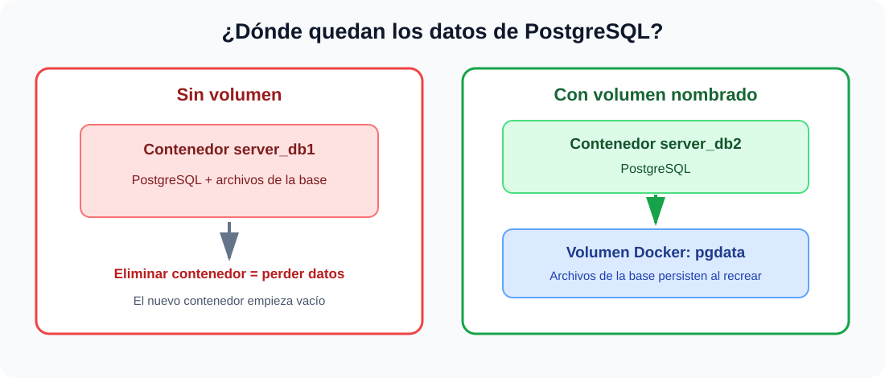

# Práctica No. 3: Crear volúmenes para persistir una base de datos PostgreSQL

> **Estado del informe:** guía reproducible con resultados esperados. La práctica y sus capturas deben completarse en un equipo con Docker; no se presentan resultados no observados como si fueran ejecución real.

## 1. Título

**Persistencia de datos en PostgreSQL con y sin volúmenes Docker**

## 2. Tiempo de duración

Registrar el tiempo real empleado al ejecutar la práctica: **_____ minutos**. El tiempo no se estima porque depende de la descarga de la imagen y de la configuración del administrador de bases de datos.

## 3. Fundamentos

PostgreSQL es un sistema gestor de bases de datos relacional. Organiza la información en bases de datos, tablas y filas, y permite consultarla o modificarla mediante SQL. Para esta práctica se crea una base llamada `test` y, dentro de ella, una tabla `customer` con un identificador, un nombre y un estado. La tabla representa información que debe seguir disponible aunque se reemplace el proceso que ejecuta PostgreSQL.

Docker empaqueta una aplicación y sus dependencias en una imagen. Al iniciar esa imagen, Docker crea un contenedor: un proceso aislado con su propio sistema de archivos, red y procesos. El contenedor facilita iniciar y eliminar instancias de software, pero los archivos escritos en su capa modificable pertenecen al ciclo de vida de ese contenedor. Por eso, al borrar un contenedor, también se pierde lo que solo estaba guardado en esa capa. Volver a iniciar la misma imagen crea otro contenedor limpio; conservar el nombre del contenedor no conserva sus archivos ni las bases de datos.

Un volumen nombrado es un espacio de almacenamiento administrado por Docker cuyo ciclo de vida es independiente del contenedor. Se monta en la ruta donde PostgreSQL guarda sus archivos de datos. El motor escribe allí los archivos de la instancia, incluidas las bases de datos creadas por el usuario. Si se elimina el contenedor y se crea otro usando el mismo volumen y la misma ruta de destino, PostgreSQL encuentra los datos anteriores y vuelve a exponerlos. El volumen no es una copia de seguridad por sí solo: puede borrarse manualmente, dañarse o quedar inaccesible. En una instalación real se requieren copias de seguridad, control de acceso, credenciales seguras y procedimientos de restauración.

La opción `-p` publica un puerto del contenedor en el equipo anfitrión para permitir la conexión de un cliente como DataGrip, TablePlus o `psql`. Por ejemplo, `5432:5432` enlaza el puerto PostgreSQL del anfitrión con el puerto dentro del contenedor. Las variables `POSTGRES_USER`, `POSTGRES_PASSWORD` y `POSTGRES_DB` configuran la instancia durante su inicialización. La contraseña del ejemplo es solo didáctica y debe cambiarse para cualquier uso real. En ambas partes se utilizan el mismo motor y los mismos datos de prueba; la diferencia experimental es que únicamente la segunda instancia monta el volumen persistente.

La comparación esperada es directa: sin volumen, después de borrar y recrear el contenedor la base `test` no debe encontrarse; con el volumen `pgdata` conservado y montado, la base y el registro insertado deben seguir disponibles. Conviene comprobarlo consultando el catálogo y los registros, y capturar cada resultado. Así se distingue entre la vida del contenedor y la vida de los datos persistentes.



**Figura 1.** Comparación del almacenamiento de PostgreSQL sin volumen y con volumen Docker.

## 4. Conocimientos previos

- Conceptos básicos de contenedores, imágenes y terminal.
- Manejo básico de Docker CLI y puertos publicados.
- Conexión a PostgreSQL desde un cliente gráfico o `psql`.
- Sentencias SQL para crear bases de datos, tablas, insertar y consultar filas.
- Uso básico de Git y GitHub para publicar el informe.

## 5. Objetivos a alcanzar

- Crear y administrar contenedores PostgreSQL mediante Docker.
- Comprobar la pérdida de datos al eliminar un contenedor sin almacenamiento persistente.
- Crear un volumen nombrado y montarlo en la ruta de datos de PostgreSQL.
- Verificar que la base de datos y sus registros sobreviven al reemplazo del contenedor.
- Explicar la diferencia entre el ciclo de vida del contenedor y el del volumen.

## 6. Equipo necesario

- Computador con Windows, Linux o macOS.
- Docker Desktop o Docker Engine en ejecución.
- Imagen oficial `postgres:16` (Docker la descarga si no está disponible localmente).
- Cliente PostgreSQL: DataGrip, TablePlus, DBeaver o `psql`.
- Conexión local al puerto `5432` libre. Si está ocupado, reemplazar el puerto del anfitrión en `-p` y conectar el cliente a ese nuevo puerto.
- Git y cuenta de GitHub para publicar el informe.

## 7. Material de apoyo

- [Plantilla de informe indicada para la práctica](https://github.com/maguaman2/informe-tendencias/blob/main/informe.md).
- [Docker Docs: volúmenes](https://docs.docker.com/engine/storage/volumes/).
- [Docker Docs: ejecutar contenedores](https://docs.docker.com/engine/containers/run/).
- [Imagen oficial de PostgreSQL en Docker Hub](https://hub.docker.com/_/postgres).
- [Documentación de PostgreSQL](https://www.postgresql.org/docs/).

## 8. Procedimiento

Los comandos están escritos para PowerShell y se ejecutan en una terminal con Docker disponible. Para Linux/macOS, se pueden ejecutar los mismos comandos reemplazando la continuación de línea si se decide dividirlos. En el cliente gráfico, usar **Host** `localhost`, **Puerto** `5432`, **Usuario** `postgres` y la contraseña definida en `POSTGRES_PASSWORD`. Conectarse inicialmente a la base `postgres`; después de crear `test`, cambiar la conexión a `test`.

### Parte 1: PostgreSQL sin volumen

1. Comprobar que Docker responde y crear el contenedor inicial. Cambia la contraseña de ejemplo antes de ejecutar:

   ```powershell
   docker version
   docker run -d --name server_db1 -e POSTGRES_USER=postgres -e POSTGRES_PASSWORD=ClaveDePractica2026 -p 5432:5432 postgres:16
   docker ps --filter name=server_db1
   ```

2. Con el cliente de base de datos, conectarse a `localhost:5432` con usuario `postgres` y la contraseña configurada. Crear la base de datos:

   ```sql
   CREATE DATABASE test;
   ```

3. Abrir una conexión a la base `test`, crear la tabla e insertar un registro:

   ```sql
   CREATE TABLE customer (
       id SERIAL PRIMARY KEY,
       fullname VARCHAR(120) NOT NULL,
       status VARCHAR(30) NOT NULL
   );

   INSERT INTO customer (fullname, status)
   VALUES ('Ana Pérez', 'activo');

   SELECT id, fullname, status FROM customer;
   ```

4. Detener y eliminar el contenedor, sin usar `-v` ni eliminar volúmenes:

   ```powershell
   docker stop server_db1
   docker rm server_db1
   ```

5. Recrearlo con la misma imagen, nombre y variables, pero sin volumen:

   ```powershell
   docker run -d --name server_db1 -e POSTGRES_USER=postgres -e POSTGRES_PASSWORD=ClaveDePractica2026 -p 5432:5432 postgres:16
   docker ps --filter name=server_db1
   ```

6. Esperar a que PostgreSQL termine de iniciar, reconectar el cliente a `localhost:5432` y consultar las bases disponibles:

   ```sql
   SELECT datname FROM pg_database ORDER BY datname;
   ```

   **Resultado esperado:** `test` no aparece; el contenedor nuevo tiene un directorio de datos inicializado desde cero.

### Parte 2: PostgreSQL con volumen

7. Detener y borrar `server_db1` para liberar el puerto. Crear el volumen nombrado y el contenedor `server_db2` asociado:

   ```powershell
   docker stop server_db1
   docker rm server_db1
   docker volume create pgdata
   docker run -d --name server_db2 -e POSTGRES_USER=postgres -e POSTGRES_PASSWORD=ClaveDePractica2026 -p 5432:5432 --mount source=pgdata,target=/var/lib/postgresql/data postgres:16
   docker ps --filter name=server_db2
   docker inspect server_db2
   ```

8. Conectarse al nuevo servidor y crear la misma base, tabla y registro. Si se reutiliza el bloque SQL, la tabla y base deben crearse solo una vez:

   ```sql
   CREATE DATABASE test;
   ```

   Conectado a `test`:

   ```sql
   CREATE TABLE customer (
       id SERIAL PRIMARY KEY,
       fullname VARCHAR(120) NOT NULL,
       status VARCHAR(30) NOT NULL
   );

   INSERT INTO customer (fullname, status)
   VALUES ('Ana Pérez', 'activo');

   SELECT id, fullname, status FROM customer;
   ```

9. Detener y eliminar el contenedor. **No** ejecutar `docker volume rm pgdata` ni `docker volume prune`:

   ```powershell
   docker stop server_db2
   docker rm server_db2
   docker volume ls --filter name=pgdata
   ```

10. Recrear el contenedor con el mismo volumen y volver a conectar el cliente:

    ```powershell
    docker run -d --name server_db2 -e POSTGRES_USER=postgres -e POSTGRES_PASSWORD=ClaveDePractica2026 -p 5432:5432 --mount source=pgdata,target=/var/lib/postgresql/data postgres:16
    docker ps --filter name=server_db2
    ```

    Consultar la base `test` y sus filas:

    ```sql
    SELECT id, fullname, status FROM customer;
    ```

    **Resultado esperado:** la base `test` y la fila de Ana Pérez permanecen disponibles.

### Evidencias que debe agregar el estudiante

Reemplazar los siguientes espacios por capturas propias, con títulos descriptivos. Evitar incluir contraseñas en las imágenes.

- **Figura 2.** Contenedor `server_db1` conectado y tabla `customer` con el registro insertado. *(Agregar captura.)*
- **Figura 3.** Lista de bases después de recrear `server_db1`, donde se vea que `test` ya no existe. *(Agregar captura.)*
- **Figura 4.** Volumen `pgdata` montado en `server_db2` o salida de `docker inspect`. *(Agregar captura.)*
- **Figura 5.** Consulta a `customer` después de recrear `server_db2`, mostrando que el registro persiste. *(Agregar captura.)*

## 9. Resultados esperados

| Escenario | Después de eliminar y recrear el contenedor | Interpretación |
|---|---|---|
| `server_db1`, sin volumen | La base `test` deja de existir en la instancia nueva. | Los datos estaban en el sistema de archivos del contenedor eliminado. |
| `server_db2`, con `pgdata` | `test`, `customer` y el registro insertado siguen disponibles. | Los archivos de PostgreSQL están en el volumen, que conservó su ciclo de vida independiente. |

Estos son resultados **esperados**, aún no verificados en este equipo. Al realizar la práctica, añadir las capturas de las Figuras 2 a 5 y anotar cualquier diferencia observada.

## 10. Bibliografía

- Docker, Inc. (s. f.). *Volumes*. Docker Documentation. https://docs.docker.com/engine/storage/volumes/
- Docker, Inc. (s. f.). *Running containers*. Docker Documentation. https://docs.docker.com/engine/containers/run/
- Docker Official Images. (s. f.). *postgres*. Docker Hub. https://hub.docker.com/_/postgres
- PostgreSQL Global Development Group. (s. f.). *PostgreSQL Documentation*. https://www.postgresql.org/docs/
- Maguaman2. (s. f.). *Plantilla: informe-tendencias/informe.md*. GitHub. https://github.com/maguaman2/informe-tendencias/blob/main/informe.md
